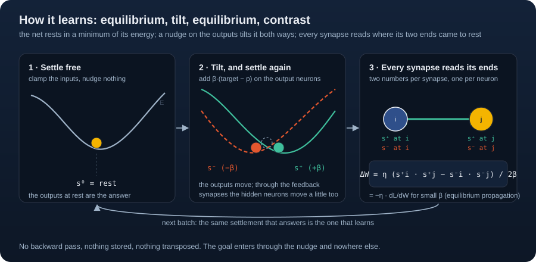

# Cadence for machine-learning people

This page maps Cadence onto models you know: which brain corresponds to which
familiar model, where each one's learning signal comes from, what the arrays look
like and what the words mean. The application interface is
`Brain.compose(..., arousal=True)`, then `brain.live(observation, reward=...)` for
each real outcome ([composition guide](brain.md), [quickstart](quickstart.md)); the
families below are the numerical mechanisms underneath and beside it.

## The picture

A Cadence brain is a set of patches joined by ports. A patch holds a bounded local
state (the potentials of a group of neurons, or one context vector), reads its
inputs through ports and updates by its declared equations. Graph models qualify a
settled state and learn from detuned phases. The [contract guide](contracts.md)
separates these cases.

## Against models you know

| Cadence | Nearest familiar model | What is different |
| --- | --- | --- |
| Settling brain (`Genome`, `develop`, `NeuralGraph`, `Learner`) | A continuous Hopfield or energy-based recurrent network trained by [equilibrium propagation](https://arxiv.org/abs/1602.05179): rate neurons relax to a fixed point, and the gradient is the contrast of a free and a nudged fixed point. | Any wiring, including a measured connectome. Reciprocal learning ties paired weights; an arbitrary directed import need not satisfy the gradient contract. A [certificate](certificate.md) says when settling is a contraction and how far the answer is from the equilibrium. Reward learns through eligibility traces and one broadcast prediction error. |

The composed brain's memories key on the observation or on the fixed sparse code
`code=units` ([the observation code](memory.md#the-observation-code)), described under
*Code* in the glossary. `evolve` mutates and selects genomes across lives
([evolution](evolution.md)).

## Where the learning signal comes from

- **The settling brain uses no backward pass through time.**
  The free settle is the answer. A second settle with the outputs nudged by `beta`
  toward the target (and, centered, a third nudged away) gives every synapse the
  product of its two neurons in each phase; the difference over `2 beta` is the
  update. On a smooth stable equilibrium with symmetric effective weights the contrast
  tends to the loss gradient as `beta` tends to zero
  ([learning](learning.md#5-why-the-contrast-is-a-gradient)). At a finite `beta` it is
  an estimate with a `beta^2` error term and a phase-solve term that grows as
  `1/beta`; the default activation's kink at zero lies outside the smooth-branch
  argument. [benchmarks/local_equilibrium](../benchmarks/local_equilibrium/README.md)
  compares the contrast learner with an implicit-gradient learner on the same network.
- **Memory stores learn by one write** of the error into the rows of the key, so two
  keys share records exactly as far as they overlap
  ([one correction](records.md#one-correction)).
- **Reward** enters the settling brain as a broadcast prediction error gating every
  synapse's eligibility trace, a three-factor rule ([reward](reward.md)).

## Compared with a backprop network

| | A network trained by backprop | A Cadence brain |
| --- | --- | --- |
| Reading an answer | Evaluate the layers | Settle to a fixed point with a residual check |
| State between inputs | A cache or a separate memory | A settled state, a carried context, a trace or a memory store, each explicit |
| Credit | Reverse-mode differentiation | Free and nudged contrasts for the settling brain; delta-rule writes for the memory stores |
| Exact-gradient conditions | A differentiable computation | For the contrast: a stable smooth equilibrium, symmetric effective weights, converged phases and a vanishing nudge |
| Work | A forward and a backward pass | Every step of the free and nudged phases plus the update |
| Memory of one event | A replay buffer or fine-tuning | One write into the store, read back at the same reading |
| Hardware | GPU tensors | NumPy float64 on the CPU; optional torch, MLX or Numba for the settling brain's graph transport ([backends](backends.md)) |

The table compares update mechanisms. Networks trained by backprop can also be
recurrent, online, model-based and memory-using, so a fair comparison measures
acquired behaviour and total work on the same task and information.

## Shapes

| Model | Inputs | Targets | State between calls | Checkpoint |
| --- | --- | --- | --- | --- |
| Composed `Brain` | `(batch, inputs)` observations; one row for `live` | `step(teacher=...)` labels the current observation; reward labels the preceding executed action | Neural activity, working trace, optional efference copy, heard history, recall slots and their address map, the associative and episodic stores with the episodic temporal context, pending outcomes | `Brain.save` / `Brain.load` keep the complete continuation |
| Neural graph / `Learner` | a drive `(batch, n)`, one column per neuron; features go on the input neurons | integer labels `(batch,)` or `(batch, slots)` for `Learner.step`, or a target pattern `(batch, n)` for the phase calls | `BrainState` per row; pass `warm=` to continue | `Learner.save` / `Learner.load`, one `.npz` |

Batch rows are independent streams sharing parameters. `imagine` is private: it
changes no learned parameter, record or live activity, though cost counters may count
its work.

## Glossary

- **Patch.** A bounded unit with local state, ports, readback and a repair rule: a
  group of neurons with their synapses.
- **Port.** A declared band of a patch's state that another patch, or the world,
  reads or drives: a population of a connectome.
- **Settle, settling.** Repeating local updates under fixed evidence. A settle
  qualifies when the component's declared equation or stationarity check passes; small
  movement or an exhausted iteration budget is insufficient.
- **Equilibrium.** A state satisfying the component's settlement contract under fixed
  boundary conditions. For the neural graph these include drive, parameters and held
  memory readback.
- **Residual.** A model-specific number, for the neural graph the equation error
  ([contracts](contracts.md)). A residual says nothing about task success.
- **Certificate.** The contraction bound that says settling has a unique equilibrium
  and how far the last step's movement leaves the state from it.
- **Free phase, nudged phase, beta, centered.** The settle under the inputs alone; the
  settle with the outputs pulled toward (or away from) the target with strength `beta`
  (default 0.1), where smaller is closer to the gradient and weaker; `centered` (default
  on) contrasts the plus and minus `beta` phases over `2 beta`.
- **Detuning, contrast.** Perturbing an equilibrium and reading the difference between
  the perturbed and the free state; the learning signal of the settling brain.
- **Code.** The fixed random expansion of an observation onto `expansion` units, of which
  the `winners` strongest positive entries stay (`code=units`, `PatternSeparator`); the
  sparse key of a store.
- **Readback.** The detached state, residuals, counters and revision of a patch, as
  observations an application or another patch's port can read.
- **Genome, develop, region, cortex, projection.** The declaration of a settling
  brain's regions and projections; its deterministic layout into one connectome; a
  named population; a builder of a standard region; a declared bundle of synapses.
- **Connectome.** The synapse list of a settling brain (`pre`, `post`, `count`, `sign`)
  and its named populations.
- **Efficacy, gain, log_gain, bias.** The learned signed strength of a synapse; the
  neuron model's global gain (`NeuronModel.gain`); the per-neuron scale of a neuron's
  outgoing synapses, applied as `exp(log_gain[pre])` and fixed by the learner; the
  learned per-neuron offset.
- **Eligibility trace, dopamine, valence.** Per-synapse memory of recent contrasts; the
  broadcast prediction error that gates them; the object that centers and caps it.
- **Receipt.** A JSON file binding a result to the sources that produced it, with a
  digest and a verifier ([receipts](receipts.md)).

## Reading the numbers

Measure settling, learning and memory maintenance separately on the same held-out data, and compare against the simple control the task
admits: the majority outcome, persistence, a linear predictor, the search alone or the
algorithmic solver. [Evaluate a brain](evaluation.md) lists the checks and
[common missteps](evaluation.md#common-missteps).

## Further reading

- Learning rule: [equilibrium propagation](https://arxiv.org/abs/1602.05179) and its
  [centered estimator](https://arxiv.org/abs/2006.03824).
- Memory stores: the cerebellar sparse expansion with a linear readout of
  [Marr (1969)](https://doi.org/10.1113/jphysiol.1969.sp008820) and
  [Albus (1971)](https://doi.org/10.1016/0025-5564%2871%2990051-4); the
  [delta-rule fast-weight memory](https://arxiv.org/abs/2406.06484); fast and slow
  [complementary learning systems](https://web.stanford.edu/~jlmcc/papers/McCMcNaughtonOReilly95.pdf)
  (McClelland et al., 1995) with their retention and interference tradeoffs.
- Reward: [prediction errors](https://www.gatsby.ucl.ac.uk/~dayan/papers/sdm97.html)
  (Schultz et al., 1997); eligibility-based online recurrent learning
  ([Bellec et al., 2020](https://www.nature.com/articles/s41467-020-17236-y)), from
  whose e-prop Cadence's rule differs.
- Acquisition and language: word/referent learning across ambiguous situations
  ([Smith and Yu, 2008](https://pmc.ncbi.nlm.nih.gov/articles/PMC2271000/)); live
  interaction in infant phonetic learning ([Kuhl et al., 2003](https://doi.org/10.1073/pnas.1532872100));
  communication and thought as distinct ([Fedorenko et al., 2024](https://www.nature.com/articles/s41586-024-07522-w));
  [speech-planning experiments](https://pubmed.ncbi.nlm.nih.gov/26858678/) on
  incremental formulation.

The [paper](https://philpapers.org/rec/MUECAP-2) states the hypotheses, the theorems
and the evidence.
