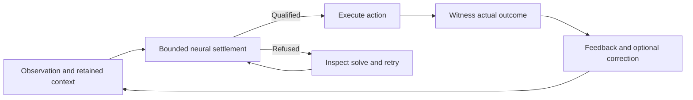

# Start a continuing brain

You want a creature in a body: a brain that senses, acts, learns from what its actions bring
and keeps living. `Brain.compose(inputs, actions, arousal=True)` builds it and `live` runs its
life, one call per moment. Five settings meet you first: `inputs` (the observation's width, or
an image shape), `actions` (the motor choices), `arousal` (on for `live`), `seed`, and `code`
(a sparse code for wide observations, [senses](senses.md)). Six calls carry the life:
`compose`, `live`, `wait` (a moment whose outcome is still to come), `reset` (a new stream),
and `save` with `Brain.load` to continue it later. [Teach](teach.md), [reward](reward.md),
[memory](memory.md) and [tune](tune.md) take each part further.

Install Cadence as described in [the documentation's install section](README.md#install),
then build one **System 1** brain with `Brain.compose` and run it with `brain.live`.

```python
from cadence import Brain

brain = Brain.compose(inputs=4, actions=2, arousal=True)
action = brain.live([[1.0, 0.0, 0.0, 0.0]])
```

By default `compose` builds one association region (`modules=(64,)`) between the
sensory and motor neurons, a working trace that carries the last interpretation into
the next settle, and an associative memory that consolidates what it writes. Every
region settles together into one equilibrium, and that equilibrium is the answer.
[One continuing equilibrium brain](#one-continuing-equilibrium-brain), below, describes the life
this brain is meant to live: bootstrap an interpretation, use it, repair witnessed failures and continue.

## Observe, act and learn

```python
import numpy as np

observation = np.array([[1.0, 0.0, 0.0, 0.0]])

# Execute the choice in a tiny environment: action 0 earns one unit.
reward = (action == 0).astype(float)
next_observation = np.array([[0.0, 1.0, 0.0, 0.0]])
action = brain.live(next_observation, reward=reward)
assert action.shape == (1,)
assert brain.learner.updates > 0
```

`live` follows one continuing stream. Pass one observation row, execute the returned
action index, and report that action's actual outcome as `reward` with the next
observation. A young brain (its first 100 moments, `arousal_youth`) or an aroused one
samples its action, learns from the outcome and writes memory. A calm brain answers
greedily from one settle and learns nothing.
Call `reset()` before starting a different stream. `brain.last_arousal` holds the
readings of the latest moment.

For batches, teaching labels or learning from every outcome, use
[`step`](teach.md#explicit-learning-with-step). Named overrides such as
`actor_eta=0.1` change a rate at construction, and `brain.retune(...)` changes
selected settings without losing acquired state. `brain.describe()` and
[the defaults table](tune.md#defaults-and-expert-overrides) show what is running.

## Inspect the work of answering

```python
report = brain.last_settlement
assert report is not None and report["qualified"]
assert report["max_residual"] <= report["tolerance"]
print("free-answer sweeps:", report["steps"], "residual:", report["max_residual"])
```

`last_settlement` is a read-only report of the latest free-answer solve, refused
attempts included: sweeps, residual, residual checks and damping halvings. It leaves
out reward eligibility, teaching and memory work. A small residual means the network
agrees with itself; whether the action was good is measured by the task's outcomes.
The [continuing example](../examples/continuing_brain.py) tracks these counters
through bootstrap, unchanged conditions, disruption and correction.

## Imagine privately and resume

```python
phases = brain.imagine([observation, next_observation])
assert len(phases) == 2 and all(np.all(phase.qualified) for phase in phases)

brain.save("brain.npz")
resumed = Brain.load("brain.npz")

# Resume the same pending action with the same measured outcome.
reward = (action == 0).astype(float)
continued = brain.live(observation, reward=reward)
replayed = resumed.live(observation, reward=reward)
assert np.array_equal(continued, replayed)
assert brain.arousal.to_dict() == resumed.arousal.to_dict()
assert brain.last_arousal == resumed.last_arousal
```

`imagine` settles the brain's responses to a supplied sequence of observations
along a private trace. Live memory, parameters, random state and pending feedback
are unchanged. A refused phase ends the branch and stays in the result, so check
each phase's `qualified` flags before using a response. `Brain.compose` builds no
transition model.

`save` and `load` keep the brain's full continuation, pending feedback included.
Save the environment separately and resume its stream as well. If `live` refuses
an answer, the [qualification rules](#qualification-and-refusal) say
how to retry without reporting an outcome twice.

## Add optional observers

**System 2** adds observer regions to the same graph:

```python
recursive = Brain.compose(
    inputs=4, actions=2, modules=(16, 8), observers=(8,), seed=7,
    arousal=True,
)
assert recursive.live(observation).shape == (1,)
```

Observers read from and return influence to the processing regions, the motor
region and earlier observers, inside the same settlement and the same `live` and
`step` calls. They attach to any module count; this project adds them to a developed
two-module System 1 by convention. Any task advantage they bring has to be learned
and measured. [Compose a brain](tune.md#brain) covers modules and observers.

## One continuing equilibrium brain

Cadence builds one brain that acquires a reusable interpretation of its world,
carries it through experience and repairs it when experience disagrees.
Perception, memory and action constrain one another through reciprocal
connections, and the answer is read from the settled state of the brain's motor
population.

The learned relations and retained memories encode a family of possible
equilibria, one for each combination of evidence and context. Learning changes
the family; ordinary use moves between its members as observations, goals and
context change.

`Brain.compose` builds the default **System 1** brain: reciprocal processing
regions, local plasticity, a working trace and associative memory. Optional
**System 2** observers add regions with returning feedback inside the same
settlement. Biological names describe software roles.

### Bootstrap, use, repair, continue



1. **Bootstrap.** Present real observations, consequences and demonstrations to
   one brain until its connections and memory support answers with the teacher
   absent. Judge this on held-out experience and retention.
2. **Use.** New evidence and remembered context change the boundary of the solve;
   the regions settle a compatible present state, the brain acts and the
   environment supplies the consequence.
3. **Repair.** Compare the issued action, or a saved prediction, with the observed
   outcome before correcting. A missed goal is task evidence; a large equation
   residual means the solve did not qualify. `Brain.live` receives the measured
   reward and predicts no environmental transition.
4. **Continue.** Keep parameters, memories and pending feedback through the
   correction, and measure recovery and old capabilities on the same brain.

The [common missteps](evaluate.md#common-missteps) list what this lifecycle rules out.

### A life in code

Compose a brain with arousal and call `live` once per moment. Each call receives
the preceding action's outcome and chooses the next action; arousal decides when
the brain explores and learns.

```python
import numpy as np
from cadence import Brain

brain = Brain.compose(inputs=2, actions=2, arousal=True)
observations = np.eye(2)
cue = 0
action = brain.live(observations[[cue]])

for transition in range(8):
    target = 1 - cue if transition < 4 else cue  # the body's rule changes halfway
    reward = (action == target).astype(float)    # outcome of the executed action
    cue = 1 - cue
    action = brain.live(observations[[cue]], reward=reward)

assert brain.learner.updates > 0
assert brain.hippocampus is not None and brain.hippocampus.writes > 0
```

`live` takes the preceding outcome before it settles the current observation; if
that settle refuses, retry `live(observations)` without the reward
([refusal](#qualification-and-refusal)). Use `step` for batches,
supplied teachers or learning from every outcome. The
[lifecycle example](../examples/continuing_brain.py) runs bootstrap, unchanged and
changed conditions and resumes from a saved pending action.

### One moment in causal order

1. Receive the observation and the feedback for the **preceding action**.
2. Score its saved prediction before the learner sees the outcome. Update from the
   observed components and apply reward to the saved eligibility of that action.
3. Retain relevant actual events with their time, context and provenance.
4. Combine current evidence, remembered events and the goal. Imagination uses
   isolated branch state and read-only parameters.
5. Save the next prediction, execute the action or utterance, and attend to the
   result.

A missing feature differs from an observed zero: give the reading a missing flag
for it, in witnessed and imagined readings alike. A UI tick or other host event is
no action outcome; report each issued action's outcome once, success included.

`Genome`/`develop` connect regions by declared
synapses. Put regions that should settle jointly into one `NeuralGraph`;
independent solves shown side by side are uncoupled dynamics. Wire an auxiliary
memory's recall into declared drive ports and count its store in the cost. A
named region gets a function only from its connections and experience.

### What the composed brain provides

The composed `Brain` provides a continuing interpretation, action and memory. It
integrates no learned model of environmental transitions
([issue #93](https://github.com/muellerberndt/cadence/issues/93)).

| Mechanism | Contract and boundary |
| --- | --- |
| Present interpretation and action | `Brain.act` qualifies the whole neural graph's residual with the trace and memory reads held as drive. With `memory_choice=True` the episodic vote joins the motor readout after the settle. The memory stores do not equilibrate jointly with the graph. |
| Settling work | `Brain.last_settlement` reports free-answer residuals, sweeps, checks and qualification, refused attempts included. Eligibility, teaching, feedback, imagination and memory work are excluded; [`record_settlements`](api.md#record-every-settling-step) records every settlement, learning and imagination included, at a memory and copy cost. |
| Memories | Working trace and associative store on; efference copy, heard history, episodic and recall memory opt-in. Each is read as held drive (the episodic vote joins after the settle) and written after the settle. [Memory](memory.md#memory-in-the-composed-brain). |
| Local correction | Teacher labels change graph parameters, the address map of a recall memory and, with `memory_choice=True`, the episodic records. Chosen-action outcomes drive reward plasticity and associative writes. A label credits no earlier action. |
| Routine and repair | `Brain.live`, for a brain built with `arousal`, answers greedily from one qualified settle while calm and changes no parameter or associative record; the trace, heard history and recall slots advance. Surprise, a reward shortfall or an unmet `need` or `need_scale` (founders 0) raises arousal, and the outcome that wakes the brain is written to its associative store. The first `youth` moments (100) and aroused moments sample, keep eligibility and learn, from success too. One stream; the law's constants are genes. [Routine and repair](#routine-and-repair-live). |
| Private imagination | `Brain.imagine` settles **supplied** observation sequences with a private trace and read-only durable memory. It learns nothing and generates no environmental transition. [Private imagination](#private-imagination). |

`step` learns from every outcome it is given. `live` gates learning by arousal;
its evidence is the [odour nursery](../benchmarks/reversal/README.md), where the
associative memory carries the repair. Reuse of a settled state across moments
and repair confined to declared dependencies belong to
[issue #122](https://github.com/muellerberndt/cadence/issues/122).

Components for compositions beyond the default brain:

| Function | Build with | Learned or supplied explicitly |
| --- | --- | --- |
| Perception and grounding | Input regions, associations and local updates (`Brain.compose`, `Genome`) | Features, entities, word/referent bindings |
| Episodes and consolidation | `FastSynapses`, `SynapticMemory` | Addressing, relevant writes, retention, correction |
| Workspace and goals | Recurrent state, `Trace`, goal and readback ports | Persistent context, goals and subgoals |
| Action and value | `ActorCritic`, eligibility, dopamine | Exploration, delayed credit |

### Coherent behavior over time

The target is behavior governed by continuing learned context: a phrase, sentence
or action sequence unfolds one event at a time with sensory feedback, carried by
the working trace, associative memory and efference. Next-event accuracy or a
self-feeding rollout is component evidence. Integrated evidence retains the
context, removes or perturbs it under matched exposure, and measures recovery and
counterfactual contexts. A surprising event need not be a numerical failure.

`Brain.act` solves the present neural state with trace and memory input held,
which is no joint equilibrium over future events. Keep any addition inside the
same coupled equilibrium; no adapter may supply the answer, the phase or the
arrangement. Declare component or integrated scope in the
[evaluation contract](evaluate.md#test-coherent-behavior-over-time)
([issue #109](https://github.com/muellerberndt/cadence/issues/109)).

### Build and measure the whole life

The default sensory projection feeds a chain of processing regions without
internal synapses; neighbouring regions and the association/motor pair exchange
reciprocal signals, so even `modules=(64,)` answers by recurrent settlement.
Measure the benefit of more modules or observers.

Keep the same brain across acquisition, use, interference and repair, with
stream identities preserved and transient state reset only at declared
boundaries. Each stream keeps its own episode records, random state and pending
actions; `SynapticMemory` shares its slow weights across streams, so a
measurement snapshot must leave the live learner's shared matrix unchanged.
`Brain.save` covers the standard composition; save the environment, partner,
curriculum and replay state beside it, and custom stores with their owner.

`predict`, `accuracy` and `fit` are independent-sample controls: they read no
memory (trace, efference, history, recall or associative store), and `fit` resets
pending stream state. A
frozen evaluation loads a checkpoint, provided it holds the state the tested
capability needs. Measure residuals, task quality, retention, recovery and work
separately, and count bootstrap, stable use, learning, replay, imagination and
refused attempts. What a numerical fixed point checks is set out in
[contracts](contracts.md).

For language, the target is understanding and producing full sentences through
this continuing system. A fixed word classifier tests a narrower mechanism; an
external language model that supplies the answer is a separate baseline.

## Continuous interaction

A `Brain.compose` brain is one continuing life with no training/inference switch.
Each call is one moment: the body reports the outcome of the preceding action, the
brain settles on the present observation and issues the next action. Observations
have shape `(streams, inputs)`, the other vectors one entry per stream, and each row
stays the same stream until `reset()`. Use `live` for one creature whose arousal
decides when to learn, and `step` for batches, teacher labels or learning from every
outcome. The [first steps](#observe-act-and-learn) above are the first run, and
[one continuing equilibrium brain](#one-continuing-equilibrium-brain) the design.

### Routine and repair: `live`

`live(observations, *, reward=None, done=None, decision_id=None)` follows one stream
of a brain composed with `arousal=True`. A calm brain answers with the greedy choice
of one qualified settle and learns nothing: no eligibility phases, no parameter
change, no associative write; earlier eligibility fades one step. Two things rouse it:

- **Surprise**: the outcome contradicts the forecast made before acting, the critic's
  value of the situation. Only outcomes of the brain's own greedy choices can surprise
  it or move its usual error.
- **Want**: the recent reward falls below what this life usually pays, below
  the body's `need`, or below `need_scale` times the spread of the rewards the
  brain has learned from. The need's want is the unmet share of the need; it never
  habituates and a rare reward's small mean cannot dilute it. The scaled need is a
  need in units of that spread (opt-in, founder 0): it applies after youth, once an
  outcome has entered the scale, and follows what the life's rewards spread over.

An aroused brain samples its policy, learns from every outcome as `step` does and
writes the outcome that woke it to memory. Want heats one uniformly chosen motor slot
to `learning.temperature * (1 + heat * want)`. Every actual reward updates the income
averages, so a brain habituates to a poorer life unless a positive `need` keeps it
wanting.

```python
import numpy as np
from cadence import Brain

cues = np.eye(4)
observation, following = cues[[0]], cues[[1]]
brain = Brain.compose(
    4, 2, modules=(16,), seed=0,
    consolidation=0.25,                  # lasting memory takes half of a witnessed unit outcome
    arousal=True, arousal_youth=30,      # a short youth for a short life
    actor_eta=0.1, actor_eta_bias=0.01,  # one stream's operating point on the odour nursery
)
rng = np.random.default_rng(0)
cue = 0
action = brain.live(cues[[cue]])
modes, hits = [], []
for moment in range(600):
    rewarded = cue % 2 if moment < 300 else 1 - cue % 2   # the rule turns over halfway
    hits.append(action[0] == rewarded)
    cue = int(rng.integers(4))
    action = brain.live(cues[[cue]], reward=[1.0 if hits[-1] else -1.0])
    modes.append(brain.last_arousal["mode"])

assert modes[250:300].count("routine") >= 45 and sum(hits[250:300]) >= 45  # calm and right
assert modes[300:340].count("aroused") >= 20                               # the change wakes it
assert modes[-50:].count("routine") >= 45 and sum(hits[-50:]) >= 45        # repaired, calm again
assert brain.arousal.moments["routine"] > 4 * brain.arousal.moments["aroused"]
```

`consolidation` and the actor rates are one stream's operating point on the
[odour nursery](../benchmarks/reversal/README.md), where the composed actor rate locks
a single stream's policy. Select them again per task; [`retune`](tune.md#retune-the-same-life)
changes them in the same life.

The law, per outcome with unsigned temporal-difference error `error`:

```text
surprise = log(error / (tolerance * usual + floor * scale))   when positive, else 0
want     = max(clip((longrun - recent) / scale, 0, 1), clip((need - recent) / need, 0, 1),
               clip((need_scale * scale - recent) / (need_scale * scale), 0, 1))
level    = decay * level + (1 - decay) * (surprise + want)
```

`usual` is the running own-choice error, `recent` and `longrun` the reward at the
`fast` and `slow` rates, `scale` the spread of learned outcomes around `longrun`; a
want term with a zero denominator is zero. The `need_scale` term reads the scale as it
stood before the outcome entered it, applies after `youth` and is zero while no outcome
has entered the scale; the want and heat read afterwards use the scale as it stands. The
surprise is weighted by `value_surprise`. The brain is aroused while `level >= threshold` and for its first `youth` moments. Set genes
with `arousal_<field>` at `compose` or `retune`
([composition](tune.md#defaults-and-expert-overrides)); construction refuses values
outside their ranges, a negative `need` or `need_scale` and `fast < slow`.

| Gene | Founder | Effect |
| --- | --- | --- |
| `threshold` | 0.2 | level at or above which the brain leaves routine |
| `decay` | 0.9 | share of the level one moment hands to the next, in `[0, 1)` |
| `tolerance` | 2.0 | errors within this many usual errors are no surprise; large removes surprise |
| `floor` | 0.1 | nor are errors within this many reward scales |
| `fast` | 0.05 | rate of the recent reward; at `slow` it removes the long-run want |
| `slow` | 0.005 | rate of the long-run reward, the usual error and the scale |
| `heat` | 2.0 | temperature gain per unit of want on the heated slot; 0 removes it |
| `youth` | 100 | first moments of a life spent aroused |
| `value_surprise` | 1.0 | weight of surprise at the critic's forecast |
| `need` | 0.0 | reward per moment the body requires; 0 removes the need's want |
| `need_scale` | 0.0 | the need as a share of the reward scale, `need_scale * scale`, after youth; 0 removes it |

`brain.last_arousal` snapshots the latest moment: `mode`, `level`, `error`,
`surprise`, `want`, `temperature`, per-slot `temperatures`, `heated_slot`, `learned`,
`recorded`, `sweeps` and `learning_sweeps`; it is `None`
after construction, reset or load. `brain.arousal` counts `moments` and `sweeps` per
mode, `learning_sweeps` and `age` ([class methods](api.md#arousal-cadencearousal)).
An action that `step` or `act` sampled is adopted, so a bootstrapped brain continues
through `live` without a reset. Under `memory_choice=True` the greedy choice includes
the [episodic vote](memory.md#one-choice-for-acting-teaching-and-imagining).

At `need=0` an adult whose life always paid poorly is not roused; bootstrap it with
`step` or a longer `youth`. In the nursery the associative memory carries the
adaptation, and a minority of lives never find the moved reward. In an unchanging
world, reward noise rouses the founders for a small share of moments. A routine moment
pays one full settle.

`need_scale` is opt-in: at the founder 0 every brain and composed life is as without it. It
is outside `ArousalConfig.space()`, so seeded mutations at the founder draw as before; add it to
a space to select on it. A positive `need_scale` rouses an adult whose income falls below
that share of its learned reward spread, whatever the unit of its rewards, and leaves a life
that never paid at all calm (its scale is zero). At `need_scale=0.1`, with the actor step at
the composed founder, against the founder on fresh seeds the composed brain kept every
chamber of the preservation panel: in the [key-door chamber](../benchmarks/keydoor/README.md)
it acquired rule A on 10 of 16 lives against 8 of 16, with fed rule-ends calm on 20 of 21
and unfed ones aroused (late aroused share .10 at fed rule-ends against .84 at unfed ones,
where the founder is calm at both, .01 and .00, with 17 of 17 fed rule-ends calm and 16 of
16 lives calm in every rule); in the [prerequisite chain](../benchmarks/chain/README.md) 3 of
12 lives collapsed onto one action against 12 of 12 and 7 of 12 learned the chain against 1
of 12; the [odour nursery](../benchmarks/reversal/README.md) passed 8 of 12 lives in both;
and a two-armed bandit with reversal won 30 of 30 blocks in both. The cost follows from the
law: in a world whose income stays below the share, the want stays at the unmet share and
the level settles above the threshold, so the brain stays aroused and pays learning sweeps
at every moment. With pay at the end of the chain, 5 of 6 lives stayed aroused for .60 to
.67 of the life on an income of .017 to .022 per moment, the sixth, earning .15 per moment,
for .06, and the founder's 6 lives, all collapsed, for .02. Through `step` the gene is
inert.

<a id="observations-actions-and-reward"></a>

### Outcomes that arrive later: `wait`

When a body reports an outcome only after more frames, sense those frames with
`wait(observations)`. It settles the frame, advancing activity, working trace, heard
history and recall slots, and issues no action and takes no outcome. The awaited
action keeps its forecasts, eligibility and situation, so its outcome is credited as
an immediate one would be.

```python
creature = Brain.compose(4, 2, modules=(16,), seed=0, arousal=True)
creature.live(cues[[0]])
owner = creature.decision_id                 # the action that owns the next outcome
waited = 0
for frame in (cues[[1]], cues[[2]]):         # the reach is under way
    creature.wait(frame)
    waited += creature.last_settlement["steps"]
assert creature.pending_feedback and creature.decision_id == owner
creature.live(cues[[3]], reward=[1.0], decision_id=owner)
assert creature.decision_id == owner + 1     # the outcome was taken once
work = sum(creature.arousal.sweeps.values()) + creature.arousal.learning_sweeps + waited
```

Waits are outside arousal's counts; add their `steps` to total a stream's work. One
outcome is one temporal-difference step however many frames were waited. `decision_id`
is the arousal age of the awaiting `live` action (the first is 1), or `None`; an
outcome under another identity, or one reported twice, raises `ValueError` and changes
nothing. Give the awaited outcome an explicit `reward`, since an omitted one is a zero
outcome. There is no deadline: for an outcome that will never come, `act` replaces the
action without learning and `reset` starts a new stream. `wait` refuses without
arousal or with several streams (`ValueError`) and with no awaited action
(`RuntimeError`).

The caller decides which frames are waited and links the late outcome to its action.
Where the brain is to learn that link, as in a delayed key-door reward, report the
moments in between through `live` and leave the credit to eligibility.

### Qualification and refusal

Every action, wait and independent prediction must satisfy the full
potential/adaptation equations, observers included, to `learning.tolerance` (`3e-3`)
within `learning.free_steps` (1024). A hard solve may fall back to half-step
numerical damping inside the same budget (a `LearnerConfig(qualified=True)` learner
uses its `damping` instead); the final residual is checked against the original
model, and the teaching rule is unchanged. `tolerance=None` is refused (`ValueError`).
Other operations keep their own tolerances: `imagine` uses `1e-6`.

A refused answer raises `RuntimeError` before changing activity, memory, random state
or pending feedback. The retry depends on what was accepted first:

| What refused | State afterwards | Retry |
| --- | --- | --- |
| the forecast settle of `live`, before feedback | unchanged | the same call |
| the answer, after the outcome was accepted (`live`, `step`) | outcome learned and counted | `live(observations)` or `act(observations)` without the outcome |
| learning from the outcome (`learn` feedback solve) | memory writes, trace resets and actor changes rolled back; action pending | the same outcome |

`brain.pending_feedback` says whether the current action awaits its outcome, including
a routine choice; read it before resubmitting.

```python
answer_work = brain.last_settlement
assert answer_work["qualified"] and answer_work["steps"] <= answer_work["budget"]
assert answer_work["max_residual"] <= answer_work["tolerance"]
```

`last_settlement` snapshots the latest completed free-answer solve, refused ones
included: `operation` (`"act"`, `"wait"` or `"predict"`; `step` reports `act`,
`accuracy` and `fit` their last `predict` batch), `scope` (`"free_answer"`), `qualified`,
per-row `row_qualified` and `residual`, `max_residual`, `steps`, `budget`,
`tolerance`, `residual_checks`, `damping_halvings` and `stagnation_checks`.
Validation errors, `learn` and `imagine` leave it; reset and load clear it. It counts
answer work only: teaching and feedback work, refused teaching included, is in
`last_learning`, and [settlement records](api.md#record-every-settling-step) capture
every solver call. Reward eligibility has its own budget, `actor_eligibility_steps=12`;
qualified teaching is opt-in ([budgets](settling.md#qualified-teaching-budgets)).

### Private imagination

```python
phases = brain.imagine([observation, following], budget=1024, tolerance=1e-6)
assert all(phase.qualified for phase in phases)
```

`imagine(observations, *, budget=1024, tolerance=1e-6)` settles supplied
observations (each a batch of the live streams) on a private trace and reads durable
memory without writing it. The branch's efference copy takes in the act the brain
would issue at each phase. A refused phase ends the branch and is returned. Live state,
parameters, records, random state and pending outcomes are untouched. The composed brain
integrates no learned model of the world's consequences.

### Reset and save

`reset(*, keep=())` starts every stream afresh. It clears activity, eligibility, any
pending action, the working trace, the efference copy, the heard history
and the episodic context, plus `last_learning`, `last_settlement` and `last_arousal`. It
keeps parameters and associative records; recall slots survive only with
`keep=("slots",)` ([recall](memory.md#the-recall-memory-in-full)). Arousal starts calm with its references cleared
and its age kept, as after `brain.arousal.reset()`, so an adult at `need=0` is roused only
by surprise and can stay calm in a world that stopped paying; its reward scale is cleared
too, so a positive `need_scale` wants nothing until outcomes enter the new stream's scale.
`keep=("arousal",)` keeps the arousal state as it is: its level, its recent and long-run
reward, its usual errors, its reward scale (and with it the scaled need), their counts,
its age and its work counts carry into the new stream, as when the state saved before
the reset with `brain.arousal.to_dict()` is restored after it with `Arousal.from_dict`,
and a brain aroused when it was reset begins the new stream aroused. Where the world may
stop paying, reset keeping the arousal, set a positive `need`, or keep living without the
reset.

In a two-armed bandit with one constant observation whose paying arm moved after 300
moments (`Brain.compose(1, 2, modules=(16,), arousal=True)`, seeds 0 to 4), adults reset
by default chose the newly paying arm at none of the next 120 moments. Reset with
`keep=("arousal",)`, they fell short of the income they were used to, woke and chose as
they did living on without the reset at every one of the 120 moments, the newly paying
arm at each of the last 40; uniform random chooses it at half the moments. Reset into a
stream that paid as before, they kept their arm, calm, at all 120 moments; into one
whose arm paid 2.0 in place of 1.0, they were aroused at 9 of 600 moments and at none of
the last 40 of any seed, and the adults living on without the reset at 6 of 600. Either
reset starts the neural state afresh: in the stream that paid as before, the first 6 to
14 moments after a reset settled from rest at 32 sweeps each, and the continuing stream
needed no sweep.

```python
state = brain.arousal.to_dict()
brain.reset(keep=("arousal",))                   # the arousal state carries on as it is
assert brain.arousal.to_dict() == state
brain.save("continuing-brain.npz")
resumed = Brain.load("continuing-brain.npz")
```

A save carries parameters, critic, the learner's optimizer, random state, every trace and
memory, arousal, an action awaiting feedback and what a waiting stream has sensed; load
validates them ([formats](api.md#brain-cadence)). Resume the same rows, supply the
pending outcome once and save the environment separately.

### Defaults and the thinking clock

| Mechanism | Default in `Brain.compose` | Advances on |
| --- | --- | --- |
| Neural activity | retained | each accepted action and each `wait` |
| Memories | working trace and associative store on, the rest opt-in | as listed in [memory](memory.md#memory-in-the-composed-brain); `wait` advances the working trace, heard history and recall slots |
| Reward plasticity and demonstrations | `step`, `learn`, `lesson`, aroused `live` | actual outcomes and supplied labels |
| Arousal | off unless `arousal=True` | each outcome `live` receives |
| Observers | none unless requested | the same neural solve |
| Imagination | explicit call | supplied hypothetical observations |

No hidden thread drives the brain; the application owns scheduling. A `step` consumes
a real transition, so never call it per UI frame; frames before a `live` outcome go to
`wait`. [Memory](memory.md) describes each store.
