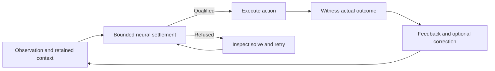

# One continuing equilibrium brain

Cadence builds one brain that acquires a reusable interpretation of its world,
carries it through experience and repairs it when experience disagrees.
Perception, memory and action constrain one another through reciprocal
connections, and the answer is read from the settled state of the brain's motor
population.

The learned relations and retained memories encode a family of possible
equilibria, one for each combination of evidence and context. Learning changes
the family; ordinary use moves between its members as observations, goals and
context change.

`Brain.compose` builds the default **System 1** brain: reciprocal processing
regions, local plasticity, a working trace and associative memory. Optional
**System 2** observers add regions with returning feedback inside the same
settlement. Biological names describe software roles.

## Bootstrap, use, repair, continue



1. **Bootstrap.** Present real observations, consequences and demonstrations to
   one brain until its connections and memory support answers with the teacher
   absent. Judge this on held-out experience and retention.
2. **Use.** New evidence and remembered context change the boundary of the solve;
   the regions settle a compatible present state, the brain acts and the
   environment supplies the consequence.
3. **Repair.** Compare the issued action, or a saved prediction, with the observed
   outcome before correcting. A missed goal is task evidence; a large equation
   residual means the solve did not qualify. `Brain.live` receives the measured
   reward and predicts no environmental transition.
4. **Continue.** Keep parameters, memories and pending feedback through the
   correction, and measure recovery and old capabilities on the same brain.

The [common missteps](evaluation.md#common-missteps) list what this lifecycle rules out.

## A life in code

Compose a brain with arousal and call `live` once per moment. Each call receives
the preceding action's outcome and chooses the next action; arousal decides when
the brain explores and learns.

```python
import numpy as np
from cadence import Brain

brain = Brain.compose(inputs=2, actions=2, arousal=True)
observations = np.eye(2)
cue = 0
action = brain.live(observations[[cue]])

for transition in range(8):
    target = 1 - cue if transition < 4 else cue  # the body's rule changes halfway
    reward = (action == target).astype(float)    # outcome of the executed action
    cue = 1 - cue
    action = brain.live(observations[[cue]], reward=reward)

assert brain.learner.updates > 0
assert brain.hippocampus is not None and brain.hippocampus.writes > 0
```

`live` takes the preceding outcome before it settles the current observation; if
that settle refuses, retry `live(observations)` without the reward
([refusal](continuous.md#qualification-and-refusal)). Use `step` for batches,
supplied teachers or learning from every outcome. The
[lifecycle example](../examples/continuing_brain.py) runs bootstrap, unchanged and
changed conditions and resumes from a saved pending action.

## One moment in causal order

1. Receive the observation and the feedback for the **preceding action**.
2. Score its saved prediction before the learner sees the outcome. Update from the
   observed components and apply reward to the saved eligibility of that action.
3. Retain relevant actual events with their time, context and provenance.
4. Combine current evidence, remembered events and the goal. Imagination uses
   isolated branch state and read-only parameters.
5. Save the next prediction, execute the action or utterance, and attend to the
   result.

A missing feature differs from an observed zero: give the reading a missing flag
for it, in witnessed and imagined readings alike. A UI tick or other host event is
no action outcome; report each issued action's outcome once, success included.

`cadence.circuits.assemble` or `Genome`/`develop` connect regions by declared
synapses. Put regions that should settle jointly into one `NeuralGraph`;
independent solves shown side by side are uncoupled dynamics. Wire an auxiliary
memory's recall into declared drive ports and count its store in the cost. A
named region gets a function only from its connections and experience.

## What the composed brain provides

The composed `Brain` provides a continuing interpretation, action and memory. It
integrates no learned model of environmental transitions
([issue #93](https://github.com/muellerberndt/cadence/issues/93)).

| Mechanism | Contract and boundary |
| --- | --- |
| Present interpretation and action | `Brain.act` qualifies the whole neural graph's residual with the trace and memory reads held as drive. With `memory_choice=True` the episodic vote joins the motor readout after the settle. The memory stores do not equilibrate jointly with the graph. |
| Settling work | `Brain.last_settlement` reports free-answer residuals, sweeps, checks and qualification, refused attempts included. Eligibility, teaching, feedback, imagination and memory work are excluded; [`record_settlements`](api.md#record-every-settling-step) records every settlement, learning and imagination included, at a memory and copy cost. |
| Memories | Working trace and associative store on; efference copy, heard history, episodic and recall memory opt-in. Each is read as held drive (the episodic vote joins after the settle) and written after the settle. [Memory](memory.md#memory-in-the-composed-brain). |
| Local correction | Teacher labels change graph parameters, the address map of a recall memory and, with `memory_choice=True`, the episodic records. Chosen-action outcomes drive reward plasticity and associative writes. A label credits no earlier action. |
| Routine and repair | `Brain.live`, for a brain built with `arousal`, answers greedily from one qualified settle while calm and changes no parameter or associative record; the trace, heard history and recall slots advance. Surprise, a reward shortfall or an unmet `need` or `need_scale` (founders 0) raises arousal, and the outcome that wakes the brain is written to its associative store. The first `youth` moments (100) and aroused moments sample, keep eligibility and learn, from success too. One stream; the law's constants are genes. [Routine and repair](continuous.md#routine-and-repair-live). |
| Private imagination | `Brain.imagine` settles **supplied** observation sequences with a private trace and read-only durable memory. It learns nothing and generates no environmental transition. [Private imagination](continuous.md#private-imagination). |
| Dreaming and sleep | `RecordPatchNet.dream` completes cues from the model and records; `sleep` teaches those completions to slow weights and rewrites residual records. Separate from `Brain.imagine` and from `Brain.compose`. [Sleep cycle](record-patch.md#acquisition-in-two-phases-records-by-day-weights-by-night). |
| Learned consequences | `TemporalPatchNet` is a separate learned temporal model with planning; `Records` give explicit predictions. Neither is wired into `Brain.compose`. [Planning](planning.md#learn-consequences-then-act). |
| Selective activity elsewhere | [Centered dopamine](reward.md#centered-dopamine-and-selective-activity) suppresses familiar actor modulation; [`Life`](steering.md) selects habit, imagination and learning for a belief/steering composition. Neither gates `Brain.step`. |

`step` learns from every outcome it is given. `live` gates learning by arousal;
its evidence is the [odour nursery](../benchmarks/reversal/README.md), where the
associative memory carries the repair. Reuse of a settled state across moments
and repair confined to declared dependencies belong to
[issue #122](https://github.com/muellerberndt/cadence/issues/122).

Components for compositions beyond the default brain:

| Function | Build with | Learned or supplied explicitly |
| --- | --- | --- |
| Perception and grounding | Input regions, associations and local updates (`Brain.compose`, `Genome`) | Features, entities, word/referent bindings |
| Consequence prediction | `Records`, one table per predicted field; `TemporalPatchNet` | Action-conditioned consequences, missing flags, rates |
| Episodes and consolidation | Valued `Records` fields at the fast rate, `FastSynapses`, `SynapticMemory` | Addressing, relevant writes, retention, correction |
| Workspace and goals | Recurrent state, `Trace`, goal and readback ports | Persistent context, goals and subgoals |
| Action and value | `ActorCritic`, eligibility, `Valence`, optional `cadence.circuits.Deliberator` | Exploration, delayed credit, useful planning |

## Coherent behavior over time

The target is behavior governed by continuing learned context: a phrase, sentence
or action sequence unfolds one event at a time with sensory feedback, carried by
the working trace, associative memory and efference. Next-event accuracy or a
self-feeding rollout is component evidence. Integrated evidence retains the
context, removes or perturbs it under matched exposure, and measures recovery and
counterfactual contexts. A surprising event need not be a numerical failure.

`Brain.act` solves the present neural state with trace and memory input held,
which is no joint equilibrium over future events. Keep any addition inside the
same coupled equilibrium; no adapter may supply the answer, the phase or the
arrangement. Declare component or integrated scope in the
[evaluation contract](evaluation.md#test-coherent-behavior-over-time)
([issue #109](https://github.com/muellerberndt/cadence/issues/109)).

## Build and measure the whole life

The default sensory projection feeds a chain of processing regions without
internal synapses; neighbouring regions and the association/motor pair exchange
reciprocal signals, so even `modules=(64,)` answers by recurrent settlement.
Measure the benefit of more modules or observers.

Keep the same brain across acquisition, use, interference and repair, with
stream identities preserved and transient state reset only at declared
boundaries. Each stream keeps its own episode records, random state and pending
actions; `SynapticMemory` shares its slow weights across streams, so a
measurement snapshot must leave the live learner's shared matrix unchanged.
`Brain.save` covers the standard composition; save the environment, partner,
curriculum and replay state beside it, and custom stores with their owner.

`predict`, `accuracy` and `fit` are independent-sample controls: they read no
memory (trace, efference, history, recall or associative store), and `fit` resets
pending stream state. A
frozen evaluation loads a checkpoint, provided it holds the state the tested
capability needs. Measure residuals, task quality, retention, recovery and work
separately, and count bootstrap, stable use, learning, replay, imagination and
refused attempts. What a numerical fixed point checks is set out in
[contracts](contracts.md).

For language, the target is understanding and producing full sentences through
this continuing system. A fixed word classifier tests a narrower mechanism; an
external language model that supplies the answer is a separate baseline.
